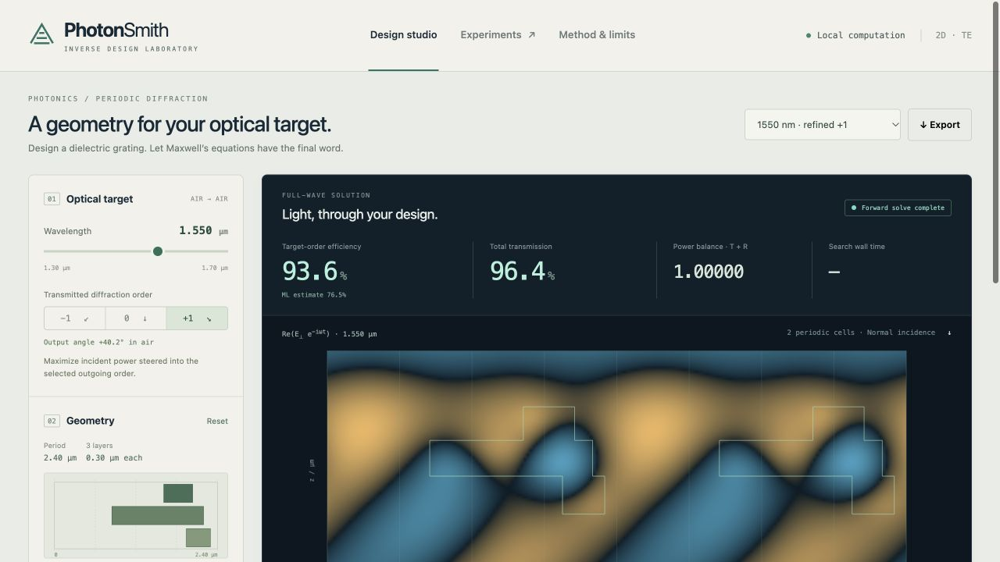
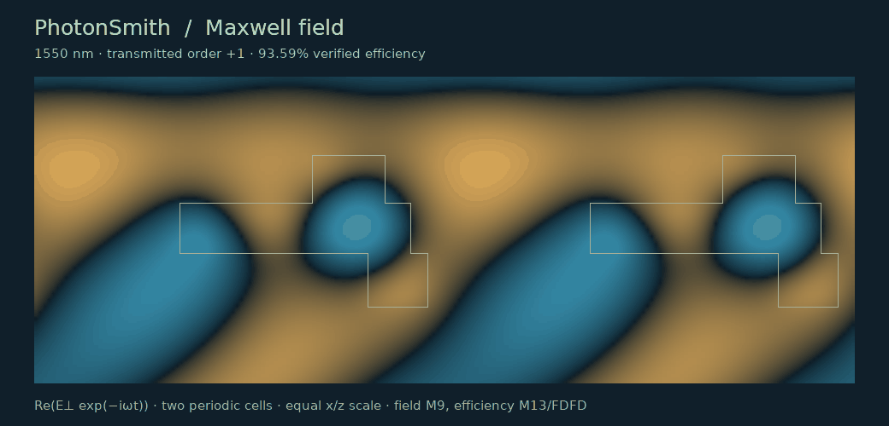
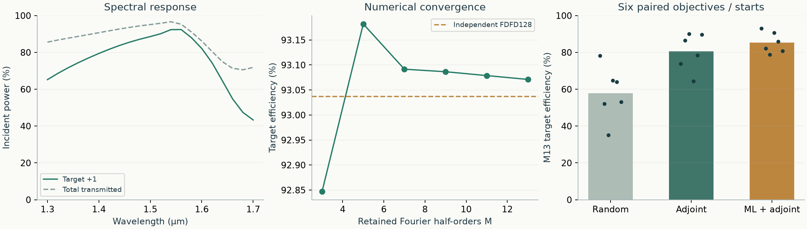
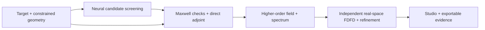

<div align="center">

# PhotonSmith

**Design where light goes. Let Maxwell's equations verify it.**

A local inverse-design laboratory for 2D photonic gratings.<br>
Neural candidate screening · constrained adjoint optimization · independent full-wave verification

[](https://github.com/nazeeh111/PhotonSmith/actions/workflows/ci.yml)
[](pyproject.toml)
[](LICENSE)

[Quick start](#quick-start) · [Measured results](#measured-results) · [Reproduce the study](docs/reproducibility.md) · [Physics](docs/physics.md) · [Limitations](#scope-and-limits)

</div>



Specify a wavelength and an outgoing diffraction order. Edit the geometry, run a neural-assisted or direct adjoint search, then inspect the electric field, spectrum, optimization trace and independent numerical checks. Export the exact design and simulation configuration for replay.

**The included 1550 nm design directs 93.59% of incident power into order +1.** An independently assembled real-space Maxwell solver gives **93.58%**, with **0.65%** relative complex-field difference over the device. These are simulated results for the explicitly defined 2D model, not fabricated-device measurements.

## Quick start

Python **3.12 or 3.13** is recommended. No API key, account or cloud service is required to run the tool.

```sh
git clone https://github.com/nazeeh111/PhotonSmith.git
cd PhotonSmith
python3.12 -m venv .venv
source .venv/bin/activate
python -m pip install -e .
photonsmith
```

Open **[127.0.0.1:8765](http://127.0.0.1:8765)**. Stop with `Ctrl+C`. If the port is occupied, `photonsmith studio --port 0` selects an available port and prints its address.

<details>
<summary>Windows, wheel installation, or an existing local environment</summary>

On Windows, use the Python launcher and the environment interpreter directly:

```powershell
py -3.12 -m venv .venv
.venv\Scripts\python.exe -m pip install -e .
.venv\Scripts\python.exe -m photonsmith
```

You can also install the wheel from [Releases](https://github.com/nazeeh111/PhotonSmith/releases). It includes the studio, trained weights, dataset and example designs, and works outside the source checkout. Run `python -m pip install path/to/photonsmith-0.1.0-py3-none-any.whl`, then `photonsmith`.

For the delivered local Mac checkout, double-click `PhotonSmith.command` if `.venv` is already installed. Regenerating experiments and figures requires a source checkout; inference, simulation, optimization and validation work from the installed wheel.

</details>

Runtime dependencies are **NumPy and SciPy**. PyTorch is optional for retraining; Matplotlib is optional for generating scientific figures. Everything runs locally. The server binds only to loopback and the browser fetches no external assets.

## Inside the studio

| Control or view | What it does |
| --- | --- |
| Optical target | Choose 1.30–1.70 µm and transmitted order −1, 0 or +1; inspect the output angle |
| Geometry editor | Adjust three bar widths and three periodic centers, with lateral bar/gap constraints |
| Design search | Compare neural screening + adjoint refinement, direct adjoint, and random search |
| Field viewer | Animate the solved complex electric field; inspect relative \|E\|² and binary geometry at equal physical x/z scale |
| Spectrum and history | Inspect 21 physical wavelength solves and every recorded optimization evaluation |
| Independent check | Compare separate Maxwell formulations and numerical refinements, with explicit acceptance criteria |
| Exports | Download SVG geometry and complete JSON parameters, fields, spectrum, trace and verification |

Start with **1550 nm · refined +1** in the sample selector, or explore the verified 1410 nm / −1 and 1630 nm / +1 designs. Edited controls mark previous results stale. Verification re-simulates an edited geometry before checking it independently.

<details>
<summary>Watch the solved monochromatic field</summary>



This is phase animation of `Re(E⊥ exp(−iωt))`, not a pulse simulation. Two periodic cells are displayed; the exported field arrays cover one cell.

</details>

## Measured results

### Strongest included design

| Quantity | Result |
| --- | --- |
| Target | 1550 nm, transmitted order +1, approximately +40.2° in air |
| Fourier-modal Maxwell, M=13 | **93.58595%** of incident power |
| Independent real-space FDFD, 128×181 | **93.58045%** |
| Efficiency disagreement | **0.00551 percentage points** |
| Complex-field relative L2 difference | **0.6502%** over the device |

[Exact configuration and convergence evidence](experiments/designs/1550nm-refined-config.json) · [Independent fine-grid report](experiments/designs/interactive-refined-validation.json)

### What the ML experiment establishes

The dataset contains **9,600 Maxwell simulations across 2,400 geometries**. A geometry-level 70/15/15 split holds all wavelengths of one geometry together. Training-only mirror augmentation and a training-only field PCA basis avoid leaking test geometries into model fitting.

| Held-out metric | Result |
| --- | --- |
| Test geometries / wavelength cases | 360 / 1,440 |
| Power MAE / RMSE, six outgoing channels | **5.82 / 8.08 percentage points** |
| Mean canonical complex-field relative L2 error | **41.5%** |
| Dataset generation / training | 63.8 s / 328.6 s on the recorded Mac environment |

**The surrogate is a candidate-screening model, not an accurate replacement for the field solver.** The studio displays Maxwell-solved fields and accepts designs through physical re-evaluation. The compact neural networks are finite-dimensional models, not demonstrated resolution-independent Fourier neural operators.

The exploratory design benchmark used three target combinations, two starts and three methods. Final quality was recomputed at M=13 for every method:

| Method | Mean efficiency, six runs | Median search time | Mean forward / adjoint evaluations |
| --- | ---: | ---: | ---: |
| Random, 32 proposals | 57.9% | 0.674 s | 33.0 / 0.0 |
| Direct adjoint, 30 iterations | 80.5% | 2.620 s | 34.2 / 33.2 |
| Neural shortlist + adjoint, 10 iterations | 85.2% | 2.003 s | 20.8 / 15.8 |

The methods have **different explicitly recorded budgets**. Search timing excludes final verification equally; the 392.4 s offline cost is separate. Local load varied and only six paired cases were studied. The observed search-only ratio is **not evidence of a robust end-to-end or general speedup**. The separately refined 93.59% design above is not substituted into this benchmark.



[Full benchmark and traces](experiments/benchmarks.json) · [Model assessment](experiments/surrogate.json) · [Prediction-error plots](docs/surrogate.png) · [Runtime versions](docs/runtime.json)

## How it works



The primary solver uses analytic binary-material Fourier coefficients, exact layer propagation and a global boundary-state solve. A direct discrete adjoint differentiates the solved system using matrix-exponential Fréchet derivatives. The independent checker builds a separate real-space finite-difference operator and integrates the geometry into its own cells. It does not reuse the primary material Fourier coefficients, propagation matrices or linear system.

[Equations and normalization](docs/physics.md) · [Architecture and code map](docs/architecture.md) · [Research foundations](docs/research.md)

## Verify and reproduce

```sh
# Physics invariants, analytic limits, gradients, splits and public API contracts
python -m unittest discover -s tests -v

# Replay the strongest configuration
photonsmith validate --fine \
  --config experiments/designs/1550nm-refined-config.json \
  --output work/validation.json
```

[The reproduction guide](docs/reproducibility.md) covers training, dataset generation, benchmark budgets, figure regeneration, asset hashes and testing an installed wheel from a clean directory. CI builds the distribution and runs numerical, workflow and real HTTP checks on Linux, macOS and Windows.

## Scope and limits

This release studies one manageable **2D directional-grating problem**: three 0.30 µm binary dielectric layers, period 2.40 µm, normal incidence, E perpendicular to the x-z plane, and air on both sides. The default real index n=2.0 is a silicon-nitride-like approximation. The supplied surrogate supports the fixed n=2 geometry family; direct physical optimization supports edited real indices.

Per-layer lateral bar widths and gaps are constrained, with a supported floor of 0.36 µm. **Inter-layer junctions, global minimum features, connectivity and manufacturing readiness are not certified.** The vertical layer height is 0.30 µm. The model omits dispersion, absorption, substrates, finite apertures, out-of-plane confinement and fabrication tolerances. Arbitrary target spectra, wavelength demultiplexers, waveguide conversion and 3D devices require additional models and experiments.

The executed verification uses the two bundled Maxwell formulations, both authored here. [Optional Ceviche and standalone Meep integrations](optional/) are clearly separated and **were not executed** against those external packages. No GPL solver source or binary is bundled. See the [license inventory](docs/licenses.md).

## Contribute or cite

Corrections supported by reproducible geometries, convergence studies and measured comparisons are welcome. See [CONTRIBUTING.md](CONTRIBUTING.md), [CHANGELOG.md](CHANGELOG.md) and [CITATION.cff](CITATION.cff).

[MIT licensed](LICENSE).
