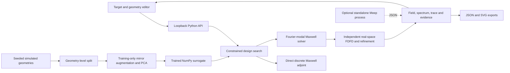
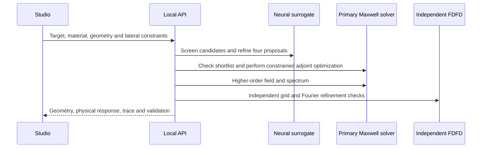

# Architecture

PhotonSmith uses ordinary NumPy/SciPy modules and a buildless browser studio. There is no task framework, database, remote inference service or required GPU.

| Module | Responsibility |
| --- | --- |
| `physics.py` | Analytic binary Fourier coefficients, global boundary-state solve, physical fields and exact discrete adjoint |
| `independent.py` | Separately assembled x/z real-space sparse Maxwell operator; additional spectral-x/FD-z diagnostic |
| `data.py` | Seeded physically simulated dataset and retained geometry-level splits |
| `surrogate.py` | Training, canonical-field PCA, portable NumPy inference and analytic neural gradients |
| `design.py` | Shared lateral bounds; neural-assisted, adjoint and random searches; explicit constraint audit |
| `reporting.py` | Public simulation format and independent convergence acceptance |
| `experiment.py` | Reproducible benchmark, cost accounting, raw traces and selected samples |
| `server.py`, `web/` | Local API, controls, scientifically scaled views and exact exports |
| `__main__.py`, `cli.py` | Installed entry point and exported-configuration replay |
| `resources.py` | Working-directory-independent source/wheel assets |
| `figures.py` | Scientific figures generated from saved experiment data |

The wheel includes the same web, model and experiment assets under `photonsmith/assets/`; source checkouts read the normal top-level folders. Runtime operations treat those bundled assets as read-only and write requested CLI outputs to the explicit destination. Research regeneration commands require a source checkout.

The studio distinguishes a neural estimate, a primary physical solution and an independent numerical acceptance. Edited inputs invalidate previous results. A passed numerical check does not mean the target is globally optimal or fabrication-ready. Search history uses M=5; displayed final fields use M=9; acceptance refines through M=13 and independent spatial grids. That distinction remains in exported provenance.
